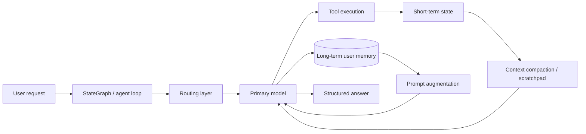
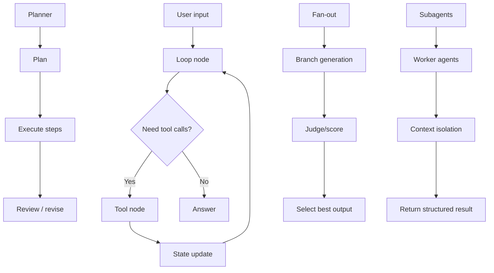

# Production Coding-Agent Harness

A LangGraph-based harness for learning and building production patterns for coding agents. The repo packages reusable agent patterns, runnable demos, and offline tests so each concept can be studied in isolation before it is assembled into a larger system.

## System overview



This harness focuses on the building blocks that show up in real coding agents:

- loop orchestration and tool use
- planner vs. reactive execution
- fan-out + judge + selection patterns
- subagent delegation and isolation
- context compaction and scratchpad management
- persistent memory and routing
- cost-aware model selection and metrics

## Repository layout

```text
.
├── README.md
├── CONVENTIONS.md
├── field-notes.md
├── pyproject.toml
├── docs/
│   ├── day-template.md
│   └── project-structure.md
├── examples/
│   ├── day01_loop.py
│   ├── day02_planner.py
│   ├── day03_fanout.py
│   ├── day04_subagents.py
│   ├── day05_context.py
│   ├── day07_memory.py
│   └── day09_routing.py
├── notes/
│   ├── langgraph-api.md
│   └── readings/
├── src/
│   └── harness/
│       ├── __init__.py
│       ├── config.py
│       ├── loop.py
│       ├── planner.py
│       ├── fanout.py
│       ├── subagents.py
│       ├── memory.py
│       ├── routing.py
│       ├── metrics.py
│       ├── context/
│       │   ├── __init__.py
│       │   ├── graph.py
│       │   ├── state.py
│       │   └── compaction.py
│       └── tools/
│           ├── __init__.py
│           ├── arithmetic.py
│           ├── meta.py
│           ├── registry.py
│           ├── scratchpad.py
│           └── stubs.py
├── tests/
│   ├── conftest.py
│   ├── test_cache_config.py
│   ├── test_day05_context.py
│   └── test_days01_04.py
└── .venv/
```

## Quick start

Requires Python 3.12+ and [uv](https://docs.astral.sh/uv/).

```bash
uv sync
```

Create a local `.env` file and set your LLM credentials before running the examples:

```bash
export OPENAI_API_KEY="..."
```

## Run the examples

Each example is a runnable LangGraph demo that exercises a specific pattern.

```bash
uv run python examples/day01_loop.py
uv run python examples/day02_planner.py
uv run python examples/day03_fanout.py
uv run python examples/day04_subagents.py
uv run python examples/day05_context.py
uv run python examples/day07_memory.py
uv run python examples/day09_routing.py
```

These demos use real model calls, so they require a valid API key and network access.

## Core modules

| Module | Purpose |
|---|---|
| `src/harness/config.py` | Central model configuration and environment-driven defaults |
| `src/harness/loop.py` | Bare ReAct loop and graph-based control flow |
| `src/harness/planner.py` | Plan-then-execute patterns |
| `src/harness/fanout.py` | Parallel branch generation and selection |
| `src/harness/subagents.py` | Delegated task execution with isolation |
| `src/harness/memory.py` | Short-term and long-term memory patterns |
| `src/harness/routing.py` | Model routing and cost-aware dispatch |
| `src/harness/metrics.py` | Usage extraction and token/cost tracking |
| `src/harness/context/` | Context state, graph logic, and compaction steps |
| `src/harness/tools/` | Shared tool registry and arithmetic/tool wrappers |

## Architecture by pattern



The repo is intentionally organized around reusable agent primitives rather than one giant monolithic application. Each example demonstrates a single pattern or design idea without hiding the mechanics behind abstraction.

## Configuration

The project reads defaults from `src/harness/config.py` and allows overrides through environment variables.

| Variable | Default | Purpose |
|---|---|---|
| `HARNESS_MODEL` | `openai:gpt-5.6-luna` | Default model for ordinary calls |
| `HARNESS_ROUTING_MODEL` | `openai:gpt-4o-mini` | Model used by routing logic |
| `HARNESS_TEMPERATURE` | `0` | Default generation temperature |
| `HARNESS_REASONING_EFFORT` | `none` | Reasoning effort used by gpt-5 models |
| `HARNESS_PROMPT_CACHE_ENABLED` | `false` | Enables prompt caching when supported |
| `HARNESS_PROMPT_CACHE_KEY` | `harness-v1` | Stable cache key |

## Development and validation

Run the local test suite and lint checks:

```bash
uv run pytest -q
uv run ruff check src examples tests
```

These are intentionally offline-friendly tests for the harness logic; they do not require a live API key for the common validation pass.

## Notes and docs

- `docs/day-template.md` documents the build ritual used for each daily pattern.
- `field-notes.md` captures what worked, what failed, and what changed over the build.
- `CONVENTIONS.md` defines the repo’s code and documentation style.
- `notes/` contains reading notes and LangGraph reference material.

## Summary

This repo is a practical harness for learning how coding agents behave under real constraints: tool use, memory, reasoning, routing, and evaluation. It is designed to be useful both as a teaching artifact and as a starting point for building a more production-grade agent system.
