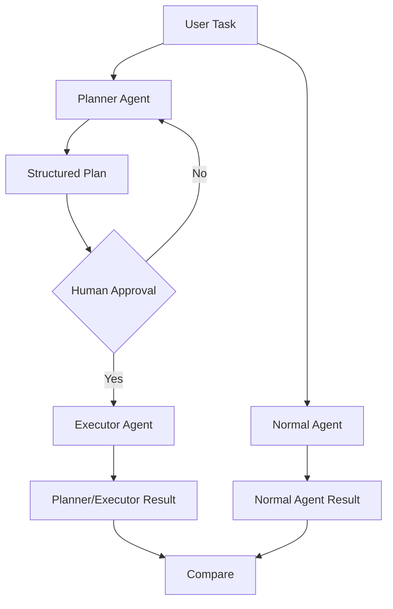

# Planning Pattern for Build and Execute Agent

This repository describes a planning pattern for building and executing agents. It separates the workflow into planner, executor, and normal agent paths.

## Overview

The flow starts with a user task and can take one of two paths:

- A normal agent handles simple tasks directly.
- A planner agent generates a structured plan for more complex tasks.

The planner path includes human approval before execution. If approval is denied, the planner can revise the plan.

## Components

- `User Task`: The input or job assigned by the user.
- `Planner Agent`: Creates a structured plan for the task.
- `Normal Agent`: Handles tasks without planning.
- `Structured Plan`: The plan produced by the planner.
- `Human Approval`: A checkpoint where a person reviews the plan.
- `Executor Agent`: Executes the approved plan.
- `Planner/Executor Result`: Output from the execution path.
- `Normal Agent Result`: Output from the normal agent.
- `Compare`: Compares results from both paths.

## Mermaid Diagram

## Usage

Use this pattern when you need:

- a planning step for complex or multi-stage tasks
- human validation before execution
- a comparison between planned execution and direct execution

## Notes

This pattern is useful for systems that require auditability and review before taking action, while still supporting fast direct execution for simpler tasks.
