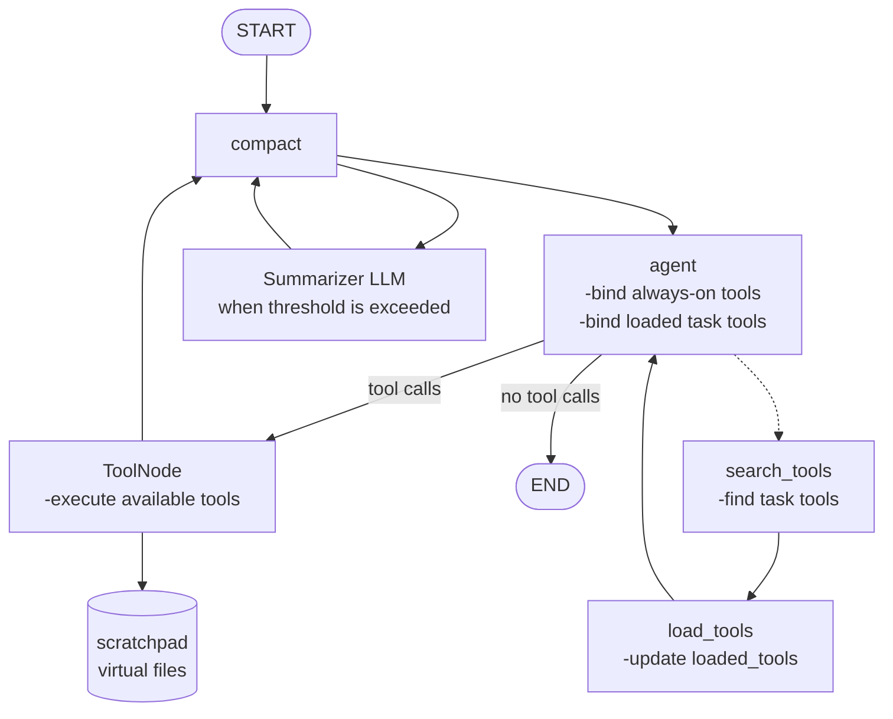

# Context-Engineered LangGraph Agent

This folder contains a small LangGraph agent harness focused on managing context deliberately:

- **Lazy tool loading:** the model searches for tools and loads only the schemas it needs.
- **Scratchpad storage:** long tool output and drafts live in a virtual filesystem instead of the conversation history.
- **Automatic compaction:** older messages are summarized when the estimated token count grows too large.
- **Thread persistence:** LangGraph's in-memory checkpointer preserves state by `thread_id`.

The task tools are intentionally lightweight stubs, so they can be replaced with database calls, APIs, or other application-specific tools.

## Architecture



`compact` runs before every agent call. It is a no-op until the message list is over both configured limits. By default, it keeps the last 6 messages and compacts when the rough estimate exceeds 3,000 tokens.

## Quick start

Requires Python 3.12+ and [`uv`](https://docs.astral.sh/uv/).

```bash
uv sync
```

Set the model provider credentials expected by LangChain, for example:

```bash
export OPENAI_API_KEY="your-api-key"
```

Run the demo:

```bash
uv run python main.py
```

The demo asks for the weather in Hyderabad and an arithmetic result. The weather and calculator tools are registered in `tools_task.py`; their implementations are local stubs and do not call external services.

## Tests

The graph tests use a scripted fake chat model, so they do not need an API key or network access:

```bash
uv run python test_graph.py
```

The tests verify lazy loading, scratchpad writes, graph routing, and compaction. They can also be run with pytest if it is installed:

```bash
uv run pytest
```

## State and tool lifecycle

The graph state is defined in `state.py`:

| Field | Purpose |
| --- | --- |
| `messages` | Conversation and tool messages, managed by LangGraph's `add_messages` reducer. |
| `scratchpad` | A `dict[str, str]` virtual filesystem for larger content. |
| `loaded_tools` | Exact names of task tools whose schemas are exposed to the model. |

Every graph starts with five always-on tools:

- `search_tools` and `load_tools` for discovering and enabling task tools.
- `read_file`, `write_file`, and `list_files` for scratchpad access.

The model should call `search_tools` when it does not know a task tool name, then call `load_tools` with exact names. Loaded tools are available on the next model turn. `ToolNode` is configured with every executable tool, while binding controls which schemas the model can currently select.

## Project layout

| File | Description |
| --- | --- |
| `main.py` | Demo entry point and model configuration. |
| `graph.py` | Builds and compiles the LangGraph state graph. |
| `state.py` | Shared `AgentState` definition. |
| `compaction.py` | Token estimation, threshold checks, and summarization. |
| `tools_meta.py` | Lazy tool discovery and loading. |
| `tools_fs.py` | Scratchpad virtual-filesystem tools. |
| `tools_task.py` | Example calculator, weather, stock, email, and translation tools. |
| `test_graph.py` | Offline graph wiring tests using a scripted model. |
| `tools.py` | Larger reusable tool-belt examples for research, integrations, and delegation patterns. |

## Extending the harness

1. Add a LangChain `@tool` function to `tools_task.py` or another module.
2. Register it in `TOOL_REGISTRY` with a concise `short_desc`.
3. Keep large results in the scratchpad with `write_file` rather than returning them in full tool messages.
4. Replace the rough token estimate in `compaction.py` with a model-specific tokenizer when deploying against a strict context window.
5. Replace `MemorySaver` with a durable LangGraph checkpointer when threads must survive process restarts.

## Configuration notes

The default model in `main.py` is `openai:gpt-5.6-luna`; change it to a model available through your configured LangChain provider. The summarizer defaults to the main chat model, but `build_graph` accepts a separate `summarizer_llm` so production deployments can use a smaller, faster model for compaction.
