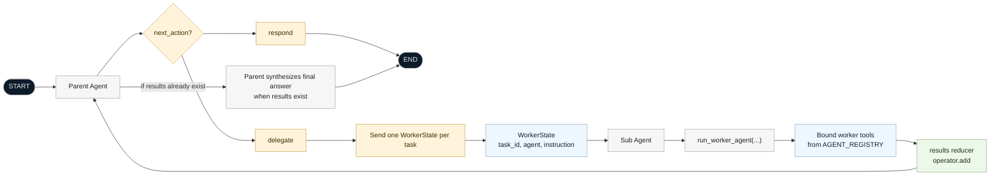

# LangGraph Sub-Agent Orchestrator

This repository contains a small multi-agent orchestration example built with LangGraph and LangChain. The main implementation lives in [subagent.py](/Users/hari/Developer/Thread/AI/agent-harness-code-snippets/Agents/subagent.py) and demonstrates how a parent agent can either answer directly or delegate isolated tasks to specialized sub-agents.

## What `subagent.py` does

`subagent.py` implements a parent/worker pattern:

- A parent agent receives the user request.
- The parent decides whether to respond directly or delegate work.
- If it delegates, it creates one or more self-contained tasks.
- Each task is executed by a sub-agent in an isolated worker context.
- Worker outputs are merged back into the parent state.
- The parent synthesizes a final user-facing answer.

The current registry includes:

- `researcher`: intended for research tasks, with `web_search_tool`
- `coder`: intended for coding tasks, with `code_exec_tool`
- `generic`: fallback worker with no tools

## Architecture

The graph is built with two nodes:

- `Parent Agent`
- `Sub Agent`

Control flow:

1. `START -> Parent Agent`
2. The parent decides between `respond` and `delegate`
3. `respond -> END`
4. `delegate -> Send(...) -> Sub Agent` for each task
5. Each `Sub Agent` returns a compressed result
6. Results are reduced into parent state with `operator.add`
7. `Sub Agent -> Parent Agent`
8. The parent produces the final answer without delegating again

## Mermaid Diagram

The diagram below matches the actual graph in `subagent.py`.



## Key Components

### 1. Agent registry

`AGENT_REGISTRY` defines the available sub-agents and their configuration:

- `system_prompt`
- `tools`
- `model`

This makes it straightforward to add more domain-specific workers later.

### 2. Isolated worker state

Each worker receives only:

- `task_id`
- `agent`
- `instruction`

It does not receive the full parent conversation history. This is the main context-isolation mechanism in the example.

### 3. Manual tool execution loop

The `run_worker_agent(...)` function handles tool calling explicitly:

- binds tools to the model
- invokes the model
- detects tool calls
- executes the requested tool
- appends a `ToolMessage`
- repeats until the model returns a final answer

This is important because `bind_tools()` exposes tools to the model, but does not execute them automatically.

### 4. Parent routing

`parent_agent(...)` has two modes:

- First pass: decide whether to answer directly or delegate
- Final pass: synthesize sub-agent outputs into one final answer

The routing function `route_after_parent(...)` returns either:

- `END`
- a list of `Send("Sub Agent", worker_state)` calls for parallel task dispatch

## File Overview

- [subagent.py](/Users/hari/Developer/Thread/AI/agent-harness-code-snippets/Agents/subagent.py): parent graph, worker logic, task routing, and example invocations
- [tools.py](/Users/hari/Developer/Thread/AI/agent-harness-code-snippets/Agents/tools.py): placeholder tool functions used by the workers
- [pyproject.toml](/Users/hari/Developer/Thread/AI/agent-harness-code-snippets/Agents/pyproject.toml): project metadata and dependencies
- [main.py](/Users/hari/Developer/Thread/AI/agent-harness-code-snippets/Agents/main.py): minimal entry file

## Requirements

- Python 3.12+
- An OpenAI-compatible model setup available to LangChain
- Environment variables loaded through `.env`

Dependencies declared in `pyproject.toml` include:

- `langchain`
- `langchain-openai`
- `langgraph`
- `openai`
- `dotenv`

## How to run

Install dependencies with your preferred environment manager, then run:

```bash
python subagent.py
```

The script currently runs two demo invocations:

- a direct-answer example
- a delegated-answer example

## Example execution flow

For a simple question, the parent may answer directly:

```text
User -> Parent Agent -> Final Response
```

For a task that benefits from specialization:

```text
User -> Parent Agent -> Task creation -> Sub-Agent(s) -> Result aggregation -> Final Response
```

## Extending the example

To add another specialized worker:

1. Define a new tool in `tools.py`
2. Register a new entry in `AGENT_REGISTRY`
3. Give it a focused `system_prompt`
4. Assign the relevant tool list
5. Update the parent prompt if you want the parent to explicitly prefer that worker type

Possible additions:

- `flight_agent`
- `hotel_agent`
- `critic_agent`
- `planner_agent`

## Current limitations

- `tools.py` contains placeholder tool implementations
- The model names are not fully consistent in the registry
  `researcher` and `coder` use `openai-gpt-5.4-mini`, while `generic` and `parent_llm` use `openai:gpt-5.4-mini`
- The script executes example calls at import/run time instead of exposing a CLI or reusable function entrypoint
- There is no persistence, tracing, retry policy, or production-grade error handling

## Why this example is useful

This is a good reference for learning:

- parent/sub-agent orchestration
- context isolation
- structured delegation
- parallel worker fan-out with `Send`
- result reduction and final synthesis in LangGraph
