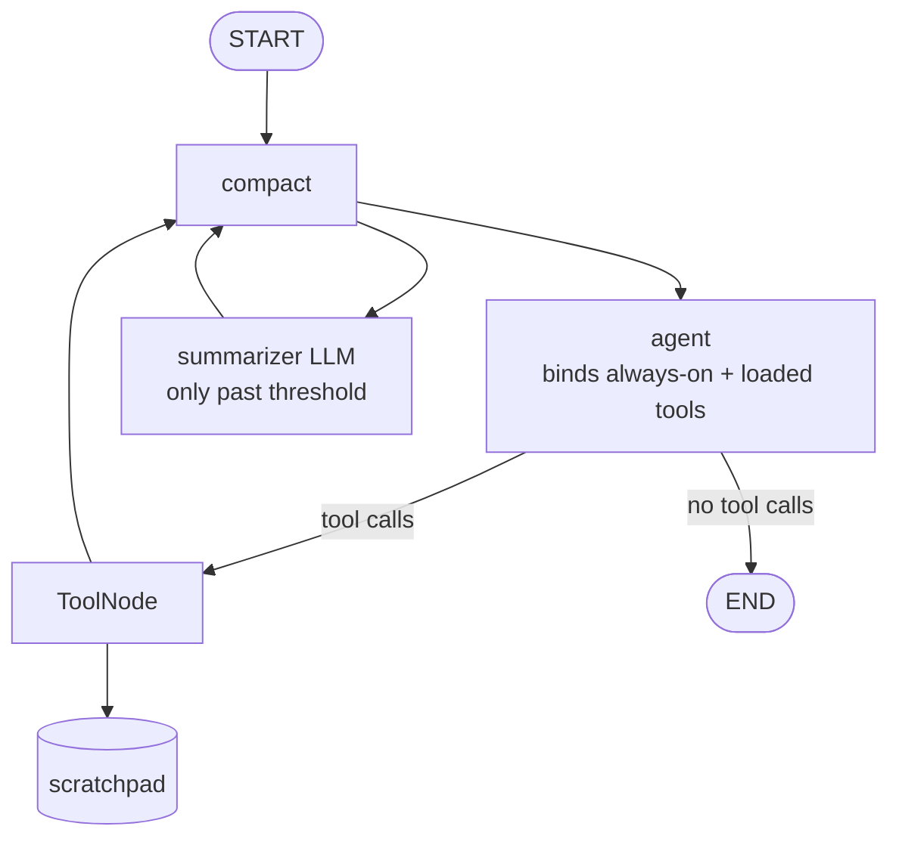

# Coding-Agent Harness — built from raw LangGraph

[](pyproject.toml)
[](src/harness/)
[](tests/)
[](pyproject.toml)
[](#the-four-week-plan)

Building a coding-agent harness from the primitives up — no `create_react_agent`,
no framework sugar. Every agent pattern is written out as a `StateGraph` so the
routing, state reduction and compaction are visible rather than inherited.

> **Status: Week 1 of 4 complete.** The five agent patterns below are built,
> importable and tested. The harness does not yet drive real code edits — the
> search and execution tools are deliberate placeholders
> ([`tools/stubs.py`](src/harness/tools/stubs.py)) until Week 3 wires the
> capstone. If you came looking for a working coding agent, it isn't one yet;
> if you came to read how these patterns are actually assembled, that part is
> done.

## What's built — the five Week 1 patterns

Each day is an importable module with a runnable demo and an offline test.

| Day | Pattern | Module | The point |
|---|---|---|---|
| 1 | ReAct loop, twice | [`loop.py`](src/harness/loop.py) | A bare `while` loop beside the `StateGraph` equivalent, so what LangGraph actually buys you — routing, state reduction, checkpointing, streaming — is legible instead of assumed. |
| 2 | Plan-and-execute vs. reactive | [`planner.py`](src/harness/planner.py) | Up-front plan with a human approval gate, against a purely reactive agent on the same task. |
| 3 | Fan-out → judge → select | [`fanout.py`](src/harness/fanout.py) | `Send` to run branches in parallel, then an LLM judge picks the winner. |
| 4 | Sub-agent delegation | [`subagents.py`](src/harness/subagents.py) | Delegation with real context isolation — the sub-agent gets a task, not the parent's transcript. |
| 5 | Context engineering | [`context/`](src/harness/context/) | Lazy tool loading, a scratchpad tool, and transcript compaction behind a token threshold. |

## Day 5 architecture



`compact` runs before **every** agent call, not just after tool runs —
otherwise a long tool-free conversation would never compact. It is a no-op
until the message list passes both configured limits (default: keep the last
6 messages, compact past ~3,000 estimated tokens).

## Quick start

Requires Python 3.12+ and [`uv`](https://docs.astral.sh/uv/).

```bash
git clone https://github.com/Harichandra1/agents.git
cd agents
uv sync
cp .env.example .env      # then fill in your keys
```

Run any day — these call a real model and need `OPENAI_API_KEY`:

```bash
uv run python examples/day01_loop.py          # bare loop vs. graph
uv run python examples/day02_planner.py       # add --auto to skip the approval prompt
uv run python examples/day03_fanout.py        # parallel branches + judge
uv run python examples/day04_subagents.py     # direct vs. delegated
uv run python examples/day05_context.py       # lazy tools + scratchpad + compaction
```

## Tests

Offline — scripted fake models, no API key, no network, so the patterns stay
verifiable without spending a token:

```bash
uv run pytest -q                      # 11 tests
uv run ruff check src examples tests
```

## Configuration

Everything reads from [`src/harness/config.py`](src/harness/config.py),
overridable via env or `.env`:

| Variable | Default | Purpose |
|---|---|---|
| `HARNESS_MODEL` | `openai:gpt-5.6-luna` | Main chat model |
| `HARNESS_SUMMARIZER` | same as above | Compaction/summarisation (Day 9 splits this) |
| `HARNESS_TEMPERATURE` | `0` | Default temperature |
| `HARNESS_REASONING_EFFORT` | `none` | Required for gpt-5.x when binding tools (see below) |

> **Why `reasoning_effort=none`:** the gpt-5.x reasoning models reject function
> tools on `/v1/chat/completions` unless reasoning effort is `none`. Every day
> from Day 1 on binds tools, so `config.py` sets it once for the whole repo.

Point `HARNESS_MODEL` at whatever `init_chat_model` accepts if you'd rather run
another provider.

## Layout

```
src/harness/          the patterns, importable
  config.py           models + settings (single source of truth)
  loop.py             Day 1  bare ReAct loop + StateGraph equivalent
  planner.py          Day 2  plan-and-execute vs. reactive
  fanout.py           Day 3  Send fan-out -> judge -> select
  subagents.py        Day 4  delegation with context isolation
  context/            Day 5  lazy tools, scratchpad, compaction
  tools/              tool definitions shared across days
examples/             one runnable demo per day
tests/                offline tests (no API key needed)
notes/                reading notes + LangGraph API notes
docs/day-template.md  the ritual for every build day
CONVENTIONS.md        the house style
field-notes.md        what clicked / what broke, per day
```

## The four-week plan

| Week | Focus | State |
|---|---|---|
| 1 | Pattern fluency — the five patterns above | **Done** |
| 2 | Production infrastructure modules | Next |
| 3 | Minimal harness + baseline benchmark | Planned |
| 4 | Error-analysis improvement loop, then deploy | Planned |

## Week 1 history

Days 1–5 were originally built on separate branches in five different styles.
They were normalised into this structure on Day 6; the originals are preserved
as tags:

```bash
git show archive/day-3:Fanout.py     # any original file, still there
```

See [`field-notes.md`](field-notes.md) for what each day taught — including the
bugs, like Day 1's arithmetic tools returning `int` when `ToolMessage.content`
must be `str` — and [`CONVENTIONS.md`](CONVENTIONS.md) for the style all of it
was normalised to.
