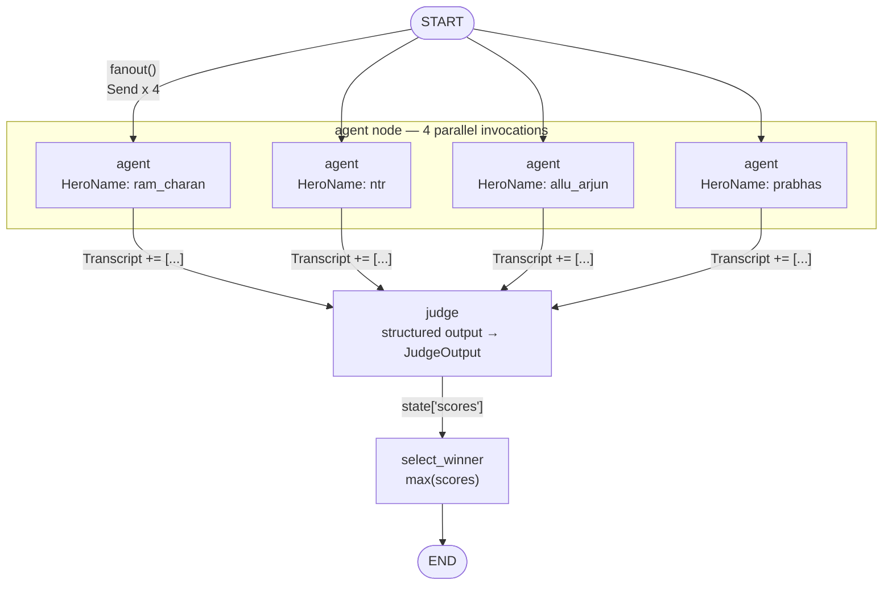

# Fanout — Parallel Agents + Judge (LangGraph)

`Fanout.py` is a small LangGraph demo of the **fan-out / fan-in** pattern: one task is dispatched to
several independent LLM agents at once, their answers are collected into a shared transcript, a judge
model scores them, and a final node picks the winner.

The running example is a debate: four Telugu heroes (`ram_charan`, `ntr`, `allu_arjun`, `prabhas`)
each argue why they are the best, and an LLM judge scores each argument out of 100.

## How it works



### 1. Fan-out with `Send`

[Fanout.py:41-42](Fanout.py#L41-L42)

```python
def fanout(state: MessagesState):
    return [Send("agent", {"HeroName": h, "task": state["task"]}) for h in hero_agents]
```

`fanout` is registered as a **conditional edge from `START`**, not as a node. Instead of returning the
name of the next node, it returns a list of `Send` objects. Each `Send` schedules one execution of the
`agent` node with its *own* private state (`InternalState`: just `HeroName` + `task`). LangGraph runs
all four in parallel in the same superstep.

This is the key idea: the number of branches is decided at **runtime** from the state, so you can fan
out over a list of any length without wiring N static edges.

### 2. Fan-in with a reducer

[Fanout.py:28-32](Fanout.py#L28-L32)

```python
class MessagesState(TypedDict):
    task: str
    Transcript: Annotated[list, operator.add]   # <- reducer
    scores: dict
    winner: str
```

Four parallel nodes all write `Transcript` in the same step. Without a reducer that would be a
conflicting write and LangGraph would raise an error. `Annotated[list, operator.add]` tells the graph
to **concatenate** the lists instead, so the four one-item lists merge into a four-item transcript.
Nothing else in the state is written concurrently, so the other fields need no reducer.

### 3. Judging with structured output

[Fanout.py:51-67](Fanout.py#L51-L67)

```python
class HeroScore(BaseModel):
    hero_name: str
    score: int = Field(ge=0, le=100)

class JudgeOutput(BaseModel):
    scores: list[HeroScore]

judge_model = model.with_structured_output(JudgeOutput)
```

The judge receives the formatted transcript and returns a validated Pydantic object rather than free
text, so `{s.hero_name: s.score for s in result.scores}` is safe to build. The commented-out block
below `judge` is the earlier version that prompted for `"number: score"` lines and parsed them by
hand — kept as a reference for how brittle the string-parsing approach is compared to structured
output.

### 4. Selecting the winner

`select_winner` takes `max(scores, key=scores.get)`, prints the score table and the winner, and stores
it on `state["winner"]`. If the judge returned nothing parseable it prints a warning and leaves the
state untouched instead of crashing.

## State shapes

| Type | Used by | Fields |
| --- | --- | --- |
| `MessagesState` | graph-level state | `task`, `Transcript` (reduced), `scores`, `winner` |
| `InternalState` | the `agent` node only | `HeroName`, `task` |

The `agent` node is declared on a graph whose state is `MessagesState`, but each `Send` hands it an
`InternalState` payload. The node reads only `HeroName`/`task` and returns a `Transcript` fragment,
which gets merged back into the parent state by the reducer.

## Running it

Requires Python ≥ 3.12 and an OpenAI key.

```bash
# .env
OPENAI_API_KEY=sk-...
```

```bash
uv sync
uv run Fanout.py
```

Output is the score dict, the winner, and the full final state:

```
Scores: {'ram_charan': 88, 'ntr': 92, 'allu_arjun': 85, 'prabhas': 87}
Winner: ntr
{'task': '...', 'Transcript': [...], 'scores': {...}, 'winner': 'ntr'}
```

The script also tries to render the compiled graph to `graph.png` via
`graph.get_graph(xray=True).draw_mermaid_png()`. That call hits a remote mermaid renderer, so it is
wrapped in a `try/except` and simply skipped (with a printed message) when offline.

## Notes / things to watch

- The model is `openai:gpt-5.4-mini`, resolved through `init_chat_model` — swap the string to change
  providers without touching the rest of the code.
- `judge` and `select_winner` mutate `state` in place *and* return it. Returning a partial dict
  (e.g. `{"scores": ...}`) is the more idiomatic LangGraph style.
- The judge sees hero names in the transcript, so scores are not blind. Formatting the transcript with
  anonymous indices (as the commented-out judge did) is one way to reduce that bias.
- Adding a hero is a one-line change to `hero_agents` — the fan-out width follows automatically.
