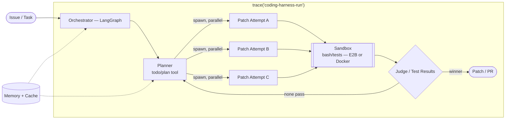

# Production Coding-Agent Harness — 1 Month Build Plan

**Capstone:** a coding-agent harness (mini Claude Code / Codex) built on raw LangGraph, evaluated with custom evals + SWE-bench Verified (Mini), improved via error analysis, deployed live with CI/CD.

**Philosophy:** minimal harness first → baseline benchmark → let real failures decide what you build next. Not a feature checklist. This is "harness engineering" (the term the field landed on in Feb 2026) and "eval-driven development" (the practice from the AI Engineering book) applied to the same project.

---

## Reading List (reference architectures)

Read these in small bites during Week 1 and Week 3 — not all at once.

| Resource | What it teaches | Read during |
|---|---|---|
| Mitchell Hashimoto — "harness engineering" post (Feb 2026) | The origin of the term; "engineer a permanent fix into the environment every time the agent errs" | Week 0/1 |
| OpenAI — "Harness engineering: leveraging Codex in an agent-first world" | A real 5-month, 1M-line case study; four concrete harness problems and their fixes | Week 0/1 |
| Pi (pi.dev) by Mario Zechner — docs + his builder essay | Minimalist harness philosophy: 4 core tools, plain ReAct loop, "lazy skills" (progressive disclosure), context compaction | Week 1, Day 5 |
| LangChain Deep Agents docs (`docs.langchain.com/oss/python/deepagents`) + source | Opinionated harness: planning tool, virtual filesystem, sub-agent "task tool", context management, built on `create_agent` on top of LangGraph | Week 1, Day 4 + Week 3 |
| "Deep Agents vs. Claude Agent SDK" comparison page (LangChain docs) | How two real harnesses solve the same problems differently | Week 3 |
| Hamel Husain & Shreya Shankar — writing on AI evals / error analysis | The actual method: open-code failures → cluster into a taxonomy → prioritize by frequency × severity | Week 3, Day 16 |
| Chip Huyen, *AI Engineering* — eval methodology chapter + AI engineering architecture chapter | You've read this — use its architecture layering (context → guardrails → router → cache → agent logic → observability) as the checklist for Week 2 | Week 2 |

---

## The Flow Method

Every build day has:
- **Core** (~2.5–3h): the non-negotiable task. Do this even on a bad day.
- **Stretch** (~1.5–2h): optional, only if you're actually in flow. Skipping it is fine and expected.

Rules:
- Low energy / short on time → Core only. Never skip the whole day — momentum > completeness.
- One rest/buffer day per week (built into the schedule below) — use it to catch up, or actually rest.
- Keep a running `field-notes.md`: every time something breaks or a pattern finally clicks, write one line about what fixed it. This becomes your interview stories and your README's "lessons learned" section.
- Weekly retro (15 min, end of each week): what worked, what didn't, adjust next week if needed.

---

## Target Architecture

The fan-out + judge branch (your "Agent Fan Wars" pattern) is a **stretch goal for Week 4**, added only if error analysis shows patch *correctness* — not exploration or planning — is your top failure mode.

---

## Week 0 — Setup (today, light, ~1–2h)

- Repo scaffold, `uv`/`poetry`, LangGraph + LangSmith installed, Docker installed, API keys sorted.
- Skim the Hashimoto and OpenAI harness-engineering posts.
- Skim Pi's homepage/philosophy and the Deep Agents overview page — just enough to recognize the vocabulary later.

---

## Week 1 — Pattern Fluency, in raw LangGraph

Goal: build each pattern once, small, so you deeply understand what frameworks abstract. Every exercise here gets reused as a module in the capstone later — nothing here is throwaway.

| Day | Focus | Core | Stretch | Notes |
|---|---|---|---|---|
| 1 | Bare loop → LangGraph | Write a ReAct loop with *no framework* (raw LLM API + while-loop + tool dispatch). Then rebuild the same thing as a LangGraph `StateGraph`. | Add streaming output. | Feel exactly what LangGraph buys you. |
| 2 | Planning pattern | Plan-and-execute agent: explicit todo/plan tool + a plan field in state. Compare vs. pure-reactive on a multi-step toy task. | Let the agent revise its plan mid-execution. | This is the "Planner" node in the architecture diagram. |
| 3 | Fan-out + judge | Build **Agent Fan Wars** literally: `Send`-based parallel branches → collector → judge node with structured-output ranking. | Swap the judge for a rubric-based structured output instead of free text. | Directly reused in Week 4 as best-of-N patches. |
| 4 | Sub-agent delegation | Build a "task tool": parent spawns a narrowly-scoped sub-agent, gets back only a *summary*, not the full transcript. Read Deep Agents' task-tool source for reference. | Give the sub-agent a restricted tool set. | This is the context-isolation pattern Claude Code / Deep Agents use. |
| 5 | Context engineering | Implement compaction (summarize older messages near the context limit) + lazy-loaded tool descriptions (Pi's "lazy skills") + a scratchpad/virtual-filesystem state. | Trigger compaction deliberately and verify nothing important got lost. | Read Pi's context-engineering notes first. |
| 6 | Rest / consolidate | Clean up the week's code. Write 1 short paragraph per pattern in `field-notes.md` — this becomes your README's "patterns used" section later. | — | Buffer day if you fell behind. |

---

## Week 2 — Production-Infrastructure Modules

Each day = one production concern from the AI Engineering architecture chapter, built as a standalone module and wired into a toy agent so you can *see* the effect.

| Day | Focus | Core | Stretch | Notes |
|---|---|---|---|---|
| 7 | Memory | Thread-level checkpointing (short-term) vs. a cross-thread store (long-term). Decide what a coding harness should actually remember (repo facts, past fix summaries, style prefs). | Add a "forget/expire" policy. | |
| 8 | Caching | Provider-level prompt caching + a tool-result cache (e.g. cache repeated file reads). Measure latency/cost with vs. without. | Cache invalidation when a file changes mid-session. | Bring real before/after numbers — good resume detail. |
| 9 | Routing | Cheap-model triage → frontier-model deep work, and/or task-type routing (read-only Q&A vs. actual patch generation). Run a small side-by-side cost/quality comparison. | Add a fallback route on tool-call failure. | |
| 10 | Sandboxing + env fluency | Real sandboxed execution (Docker locally is fine to start; note E2B / Modal / Daytona as cloud options for later). Layered config via `pydantic-settings` + `.env` for dev/staging/prod. | Try one cloud sandbox (E2B is the easiest to get running quickly). | Never let agent-written code run unsandboxed. |
| 11 | Observability + tracing | Instrument every module built so far with LangSmith (or Langfuse/OpenTelemetry if you want a vendor-neutral skill). Deliberately break something and debug it *from the trace only*. | Add custom trace metadata (task id, module name) for filtering later. | The debugging-from-a-trace skill matters more than the tool you pick. |
| 12 | Rest / consolidate | Finalize module APIs so Week 3 can just import them. Decide LangSmith vs. Langfuse for good. | — | |

---

## Week 3 — Minimal Harness + Baseline Benchmark

Goal: get a real, honest score as fast as possible, then let it tell you what to build.

| Day | Focus | Core | Stretch |
|---|---|---|---|
| 13–14 | Assemble the minimal harness | Core loop + `read`/`write`/`edit`/`bash` tools (sandboxed) + the planning tool from Week 1. **Deliberately skip** memory/caching/sub-agents/fan-out for now — mirror Pi / `mini-swe-agent` minimalism. Get it solving 2–3 toy tasks end-to-end, traced. | Add a simple retry-on-tool-error path. |
| 15 | Custom eval set | Write ~15–20 self-authored coding tasks of increasing difficulty in a toy repo, with clear pass/fail criteria (right file edited, tests pass, turn count). This is your agent's unit-test suite. | Add a couple of adversarial/edge-case tasks. |
| 16 | Baseline eval + error analysis | Run the custom eval. Read every failing trace. Open-code the failures (one note per failure, in your own words), then cluster into a taxonomy: e.g. "wrong file located," "forgot earlier plan step," "tool-call loop," "bad patch syntax." | Rank each category by frequency × severity. |
| 17 | SWE-bench Verified Mini | Set up the 50-task Mini subset end-to-end (repo checkout, docker images, harness wiring). Budget the whole day — this part is genuinely fiddly. Get *a* score, even a rough one. | Get the full custom-set + Mini both traced in LangSmith side by side. |
| 18 | Rest / plan Week 4 | Take your ranked failure list from Day 16 (+ Mini results) and turn the top 2–3 categories into Week 4's actual task list. | — |

---

## Week 4 — Error-Analysis Improvement Loop, Deploy, Polish

This week's Core tasks are **not fixed in advance** — they're whatever your Day 16/18 failure ranking says. Below is the likely shape; swap in what your data actually shows.

| Day | Focus | Core | Stretch |
|---|---|---|---|
| 19–20 | Improvement cycle 1 | Implement whichever Week 1/2 module addresses your #1 failure class (sub-agent delegation if context bloat is #1; planning fixes if plan-loss is #1; caching/routing if it's cost/latency; fan-out+judge from Day 3 if it's patch correctness). Re-run evals, measure the delta, log it. | — |
| 21 | Improvement cycle 2 | Same, for failure class #2. | — |
| 22 | CI/CD | GitHub Actions: run the fast custom eval subset on every push as a regression gate. Optional nightly job for the full SWE-bench Mini run with a score badge in the README. | — |
| 23 | Deploy live | Dockerize (FastAPI wrapper around the LangGraph harness). Deploy to Fly.io / Render / Railway. Route actual code execution to E2B/Modal (never on the app server itself). Confirm tracing works against the deployed instance. | Minimal demo UI, or a clean API + a couple of `curl` examples. |
| 24 | Benchmark + write-up | Final benchmark run. Write the harness design doc: architecture diagram, patterns used, eval methodology, before/after numbers, what you'd do next. Record a short demo. | — |
| 25+ | Buffer | Whatever slipped. Expected, not a failure. | — |

---

## Eval & Benchmark Plan (summary)

- **Custom eval set** (~15–20 tasks): fast, cheap, used every improvement cycle — your day-to-day feedback loop.
- **SWE-bench Verified Mini** (50 tasks, HuggingFace, canonical as of 2026): your resume-worthy public number. Slower/costlier — run it at baseline (Day 17) and again after the improvement loop (Day 24).
- **Error analysis method**: open-code each failure in your own words → cluster into a small taxonomy → prioritize by frequency × severity → fix the top one → re-measure. Don't skip the open-coding step; jumping straight to categories is how people miss the real pattern.

## Deployment Stack (summary)

| Layer | Choice | Why |
|---|---|---|
| App / orchestrator | FastAPI + LangGraph, on Fly.io / Render / Railway | Easy Docker deploys, cheap/free tier, public URL |
| Sandbox (code execution) | E2B, Modal, or Daytona | Untrusted agent-written code should never run on your app server |
| Tracing/evals | LangSmith (native to LangGraph) or Langfuse/OpenTelemetry | LangSmith = fastest to wire up; Langfuse/OTel = more vendor-neutral skill for your resume |
| CI/CD | GitHub Actions | Regression gate on every push; this is the detail interviewers remember |

## What Goes in the Final README

- The architecture diagram above (updated to reflect what you actually built).
- A short "patterns used" list, one line each, pulled straight from `field-notes.md`.
- Before/after benchmark numbers from the improvement loop — the single most convincing resume line.
- A short "what I'd do with more time" section — shows judgment, not just execution.
